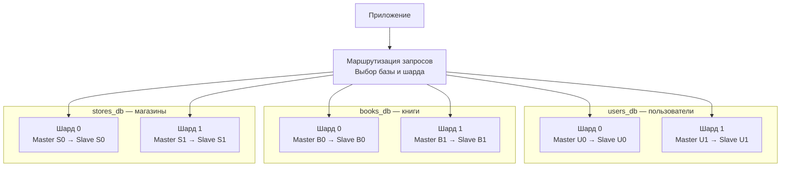

# Домашнее задание «Репликация и масштабирование. Часть 2» - Нефедов Александр

## Задание 1

Условие задания

Опишите основные преимущества использования масштабирования методами:

- активный master-сервер и пассивный репликационный slave-сервер;
- master-сервер и несколько slave-серверов.

Дайте ответ в свободной форме.

### Активный master-сервер и пассивный репликационный slave-сервер

Master обрабатывает запросы на чтение и запись. Slave получает изменения с master и хранит копию данных, но не обслуживает запросы приложения.

Основное преимущество — повышение отказоустойчивости. При отказе master можно переключить приложение на slave, предварительно назначив его новым master. Также реплику можно использовать для резервного копирования, чтобы снизить нагрузку на основной сервер.

Такая схема не увеличивает производительность записи. При асинхронной репликации возможна потеря последних изменений, которые ещё не успели попасть на slave. Переключение выполняется вручную или средствами автоматизации.

### Master-сервер и несколько slave-серверов

Master принимает изменения данных и передаёт их на несколько slave-серверов. Запросы на чтение распределяются между репликами.

Основное преимущество — снижение нагрузки на master и масштабирование чтения. Например, просмотр каталога книг можно направлять на реплики, а изменение данных — на master. При росте количества запросов можно добавлять новые slave-серверы.

Дополнительно повышается отказоустойчивость: при отказе одной реплики остальные продолжают обслуживать чтение. Нужно учитывать задержку репликации: сразу после изменения на master данные на slave могут быть ещё не обновлены. Запросы, которым нужны актуальные данные, направляются на master.

## Задание 2

Условие задания

Разработайте план для выполнения горизонтального и вертикального шардинга базы данных. База данных состоит из трёх таблиц:

- пользователи;
- книги;
- магазины.

Столбцы произвольно.

Опишите принципы построения системы и их разграничение или разбивку между базами данных.

Пришлите блок-схему, где и что будет располагаться. Опишите, в каких режимах будут работать серверы.

Базу данных разделю сначала вертикально — по назначению таблиц, затем горизонтально — по строкам внутри каждой таблицы.

### Вертикальное разделение

Таблицы размещаются в отдельных базах данных:

| База данных | Назначение | Столбцы |
| --- | --- | --- |
| `users_db` | Пользователи | `user_id`, `name`, `email` |
| `books_db` | Книги | `book_id`, `title`, `author`, `price` |
| `stores_db` | Магазины | `store_id`, `name`, `city`, `address` |

Такое разделение позволяет независимо масштабировать и обслуживать каждую часть системы. Например, увеличение нагрузки на каталог книг не потребует увеличения ресурсов базы пользователей.

Здесь вертикальное разделение означает распределение таблиц между базами, а не увеличение ресурсов одного сервера.

### Горизонтальное разделение

В каждой базе создам по два шарда с одинаковой структурой таблиц. Строки распределяются по идентификатору:

| Таблица | Правило выбора шарда |
| --- | --- |
| Пользователи | `hash(user_id) % 2` |
| Книги | `hash(book_id) % 2` |
| Магазины | `hash(store_id) % 2` |

Результат `0` означает первый шард, результат `1` — второй. Каждая запись хранится только в одном шарде, не считая её реплики.

Приложение определяет нужную базу по типу данных, затем вычисляет шард по идентификатору. Запросы без ключа шардирования, например поиск книг по автору, выполняются на всех шардах соответствующей базы с последующим объединением результатов.

### Блок-схема

Каждый блок шарда на схеме — пара отдельных серверов: master и его slave. Стрелка внутри блока обозначает направление репликации.

Схема размещения баз данных и шардов

### Режимы работы серверов

| Сервер | Режим работы | Назначение |
| --- | --- | --- |
| Master каждого шарда | Чтение и запись | Обработка изменений и запросов, которым нужны актуальные данные |
| Slave каждого шарда | Только чтение (`read-only`) | Асинхронная репликация с master и обработка запросов, допускающих задержку обновления |

При отказе master его реплика может быть назначена новым master. Перед переключением необходимо исключить запись на старый master, чтобы не допустить одновременной работы двух основных серверов одного шарда.

Связи между разными базами проверяются на уровне приложения. Обычные внешние ключи и `JOIN` между независимыми серверами не используются. При необходимости приложение отдельно запрашивает данные и объединяет результаты.

### Итог

Вертикальное разделение разграничивает пользователей, книги и магазины. Горизонтальное разделение распределяет строки и нагрузку между шардами. Репликация повышает отказоустойчивость и позволяет масштабировать чтение.

Реплика не заменяет резервное копирование: ошибочное удаление данных также передаётся на slave. Поэтому резервные копии создаются отдельно.

При добавлении шардов потребуется перенос части записей и обновление правил маршрутизации.
