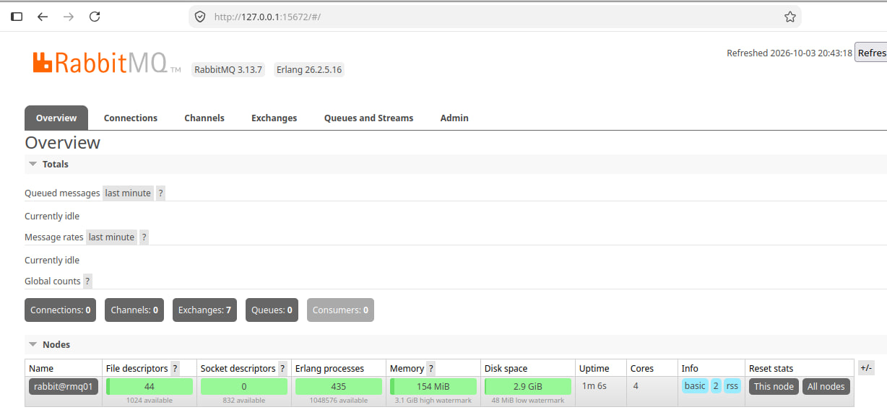
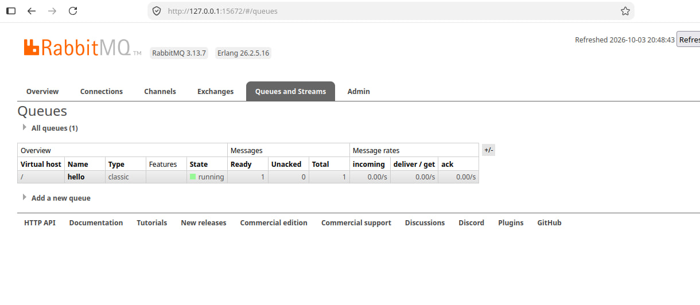
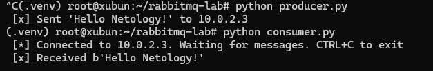
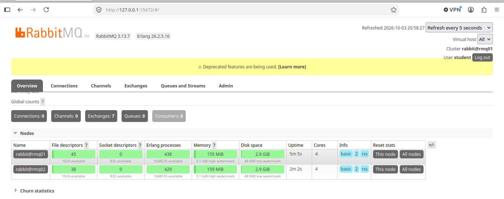
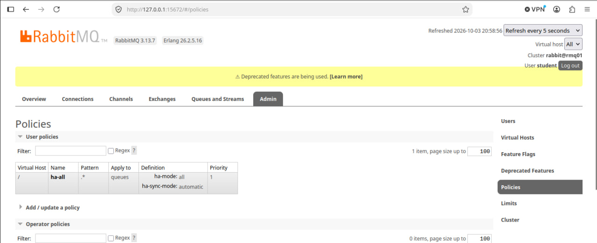
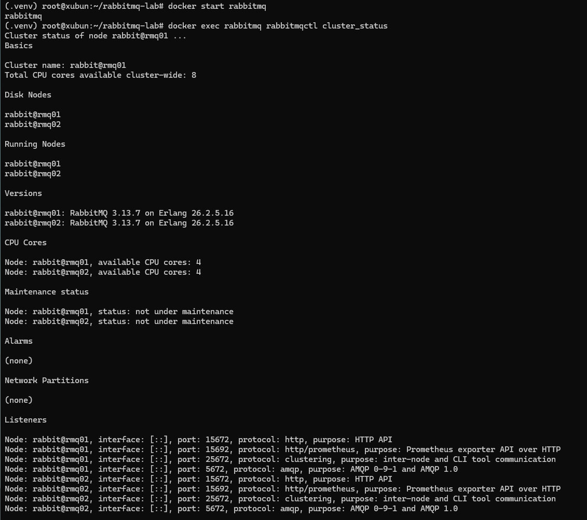
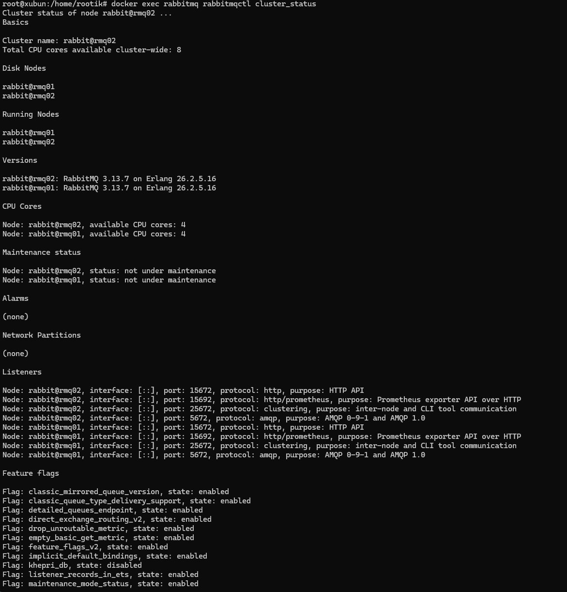
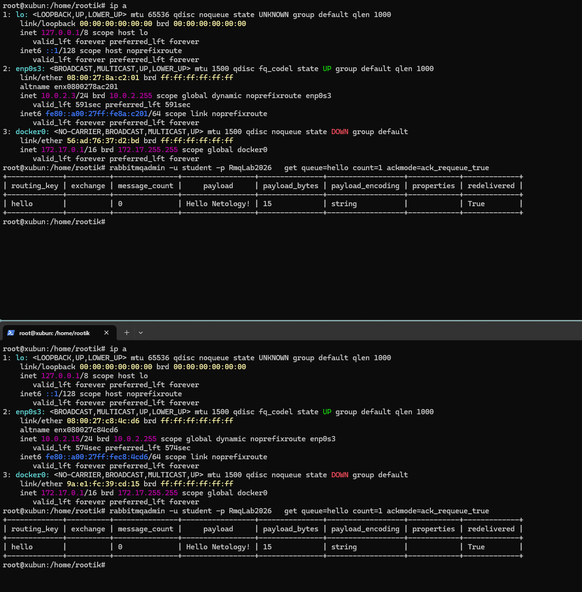
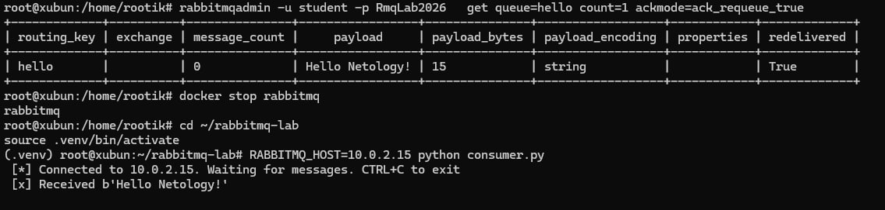

# Домашнее задание «RabbitMQ» — Нефедов Александр

## Задание 1. Установка RabbitMQ

Используя Vagrant или VirtualBox, создайте виртуальную машину и установите RabbitMQ. Добавьте management plug-in и зайдите в веб-интерфейс.

Приложите скриншот веб-интерфейса RabbitMQ.

скриншот

На ВМ VirtualBox запущен RabbitMQ 3.13.7 в Docker. Management plug-in включён, веб-интерфейс доступен на порту `15672`.

## Задание 2. Отправка и получение сообщений

Используя скрипты `producer.py` и `consumer.py`, проведите тестовую отправку и получение сообщения. Для работы скриптов установите Python 3 и библиотеку Pika, укажите IP-адрес машины с RabbitMQ вместо `localhost`.

Запустите `producer.py`, найдите очередь `hello` в веб-интерфейсе и сделайте скриншот. Затем запустите `consumer.py` и приложите скриншот результата выполнения.

скриншоты

Установлены Python 3 и Pika. Producer отправил `Hello Netology!` в очередь `hello`, в интерфейсе видно одно сообщение, готовое к получению.

Consumer подключился к `10.0.2.3` и получил сообщение.

## Задание 3. Подготовка HA кластера

Создайте вторую ВМ в Vagrant или VirtualBox и установите RabbitMQ. Добавьте в `/etc/hosts` имена и IP-адреса обеих машин, чтобы они могли обращаться друг к другу по имени.

Объедините машины в кластер и создайте политику `ha-all` на все очереди. Приложите скриншоты веб-интерфейса с доступными нодами и включённой политикой, а также вывод `rabbitmqctl cluster_status` с обеих нод.

Повторно запустите `producer.py` и приложите скриншот выполнения `rabbitmqadmin get queue='hello'` на каждой ноде. Отключите первую ноду, переключите `consumer.py` на вторую и приложите скриншот получения сообщения.

скриншоты

Создан кластер из двух нод: `rabbit@rmq01` (`10.0.2.3`) и `rabbit@rmq02` (`10.0.2.15`). Обе ноды доступны в веб-интерфейсе.

Создана политика `ha-all` с шаблоном `.*`, параметрами `ha-mode: all` и `ha-sync-mode: automatic`.

Вывод `cluster_status` с первой ноды после её повторного запуска:

Вывод `cluster_status` со второй ноды:

На обеих нодах выполнен `rabbitmqadmin get` для очереди `hello`. Использован `ackmode=ack_requeue_true`, чтобы вернуть сообщение в очередь после просмотра.

Первая нода остановлена командой `docker stop rabbitmq`. Consumer подключился ко второй ноде (`10.0.2.15`) и получил `Hello Netology!`.

