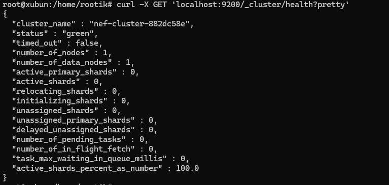
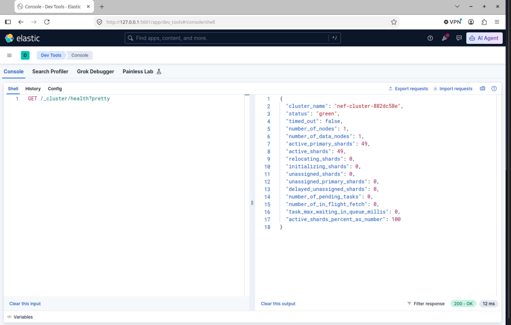
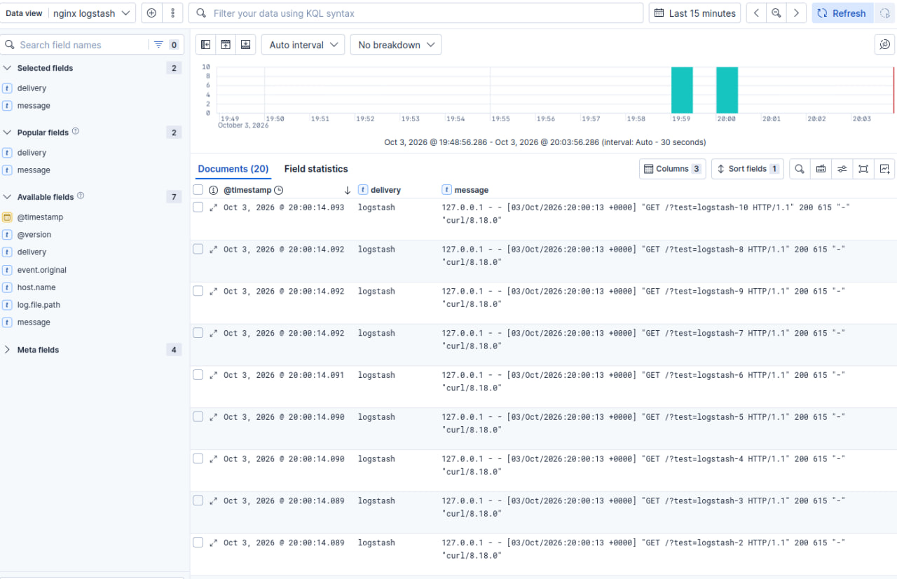
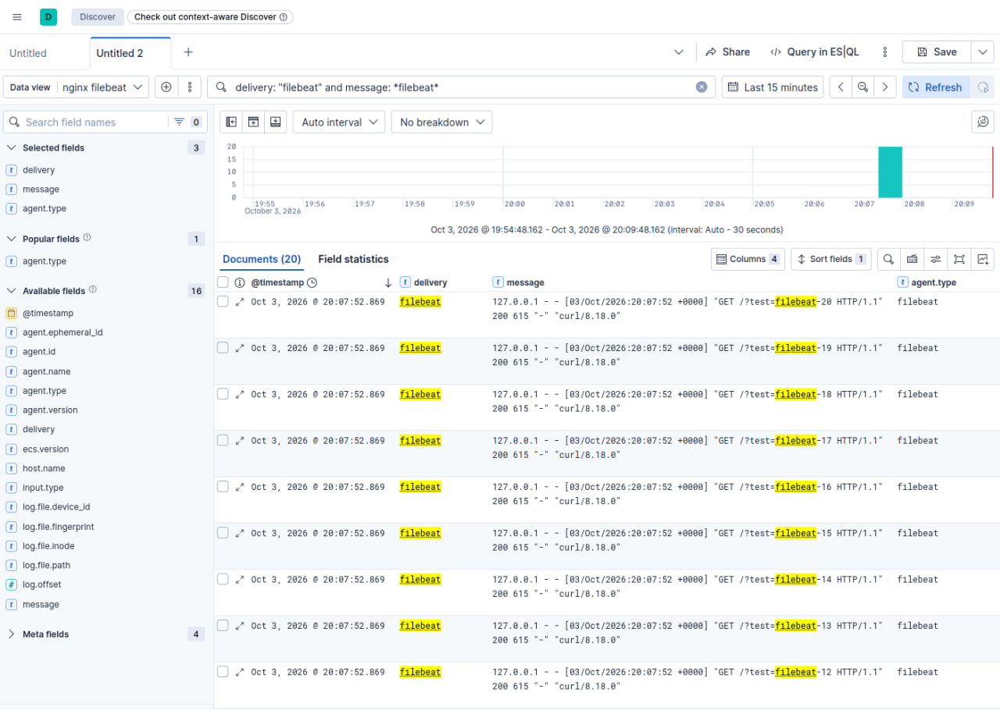

# Домашнее задание «Elasticsearch, Kibana, Logstash и Filebeat» — Нефедов Александр

## Задание 1. Elasticsearch

Установите и запустите Elasticsearch, после чего поменяйте параметр `cluster_name` на случайный.

Приведите скриншот команды `curl -X GET 'localhost:9200/_cluster/health?pretty'`, сделанной на сервере с установленным Elasticsearch, где будет виден нестандартный `cluster_name`.

Ответ — скриншот

Elasticsearch запущен. В конфигурации задано 'cluster.name: nef-cluster-$(openssl rand -hex 4)' (итог`cluster.name: nef-cluster-882dc58e`), статус кластера — `green`.

$(openssl rand -hex 4)

## Задание 2. Kibana

Установите и запустите Kibana.

Приведите скриншот интерфейса Kibana на странице `http://<ip вашего сервера>:5601/app/dev_tools#/console`, где будет выполнен запрос `GET /_cluster/health?pretty`.

Ответ — скриншот

Kibana запущена. В Dev Tools выполнен запрос `GET /_cluster/health?pretty`.

## Задание 3. Logstash

Установите и запустите Logstash и Nginx. С помощью Logstash отправьте access-лог Nginx в Elasticsearch.

Приведите скриншот интерфейса Kibana, на котором видны логи Nginx.

Ответ — скриншот

Access-лог Nginx отправляется через Logstash в Elasticsearch. В Kibana видны запросы к Nginx и поле `delivery: logstash`.

## Задание 4. Filebeat

Установите и запустите Filebeat. Переключите поставку логов Nginx с Logstash на Filebeat.

Приведите скриншот интерфейса Kibana, на котором видны логи Nginx, которые были отправлены через Filebeat.

Ответ — скриншот

Logstash остановлен, доставка логов переключена на Filebeat. В Kibana видны новые запросы к Nginx, поля `delivery: filebeat` и `agent.type: filebeat`.

